# ELEC 4 – Python Programming

Name: Kemerson d. Fernandez
Section: IV-BSIT-C
Course: ELEC 4 – Python Programming

## Set 1 Activities

- [P1 – Student Grade Calculator](set1/p1)
- [P2 – Custom Module](set1/p2)
- [P3 – Student Record Manager](set1/p3)
- [P4 – Safe Menu Program](set1/p4)

## How to Run

P1: python set1/p1/p1_grade_calculator.py
P2: python set1/p2/p2_main.py
P3: python set1/p3/p3_record_manager.py
P4: python set1/p4/p4_exceptions.py

## Screenshots

### P1 – Student Grade Calculator

The screenshot below shows the student's average,
highest grade, lowest grade, and pass/fail status.

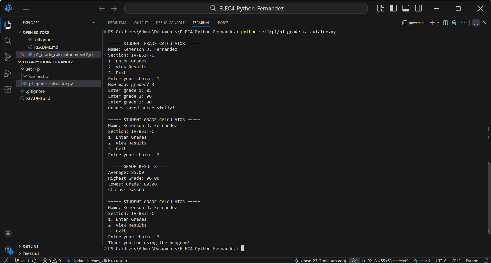

## P2 – Custom Module

This activity demonstrates the use of a custom Python module named student_utils. It includes functions for calculating the average, determining pass or fail status, and finding the highest and lowest grades. It also uses the datetime built-in module.

**Program Output:**

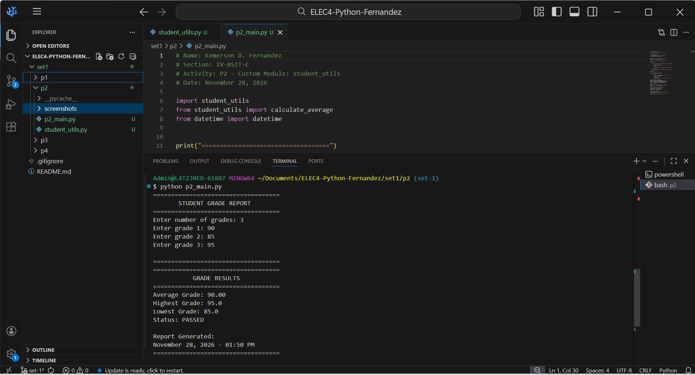

## P3 – Student Record Manager

This activity demonstrates how to manage student records using Python lists and functions. It supports adding, removing, searching, and displaying student names while preventing duplicate entries.

**Test Screenshots:**

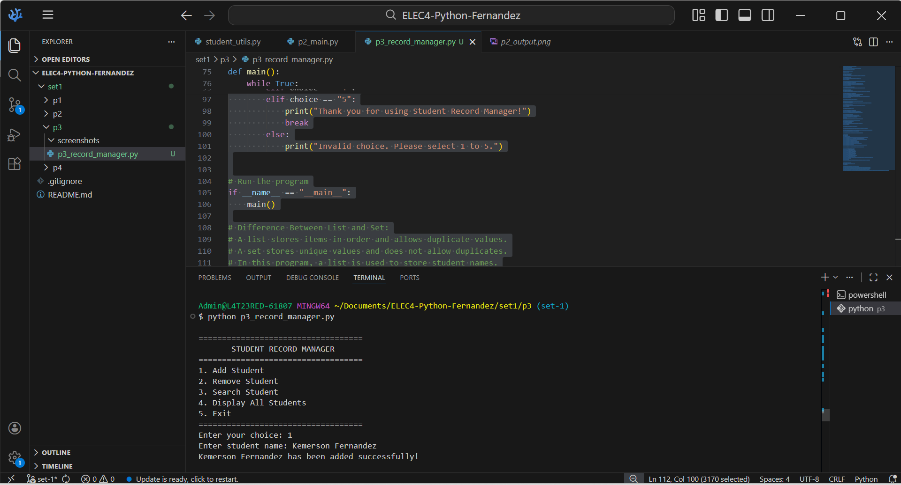

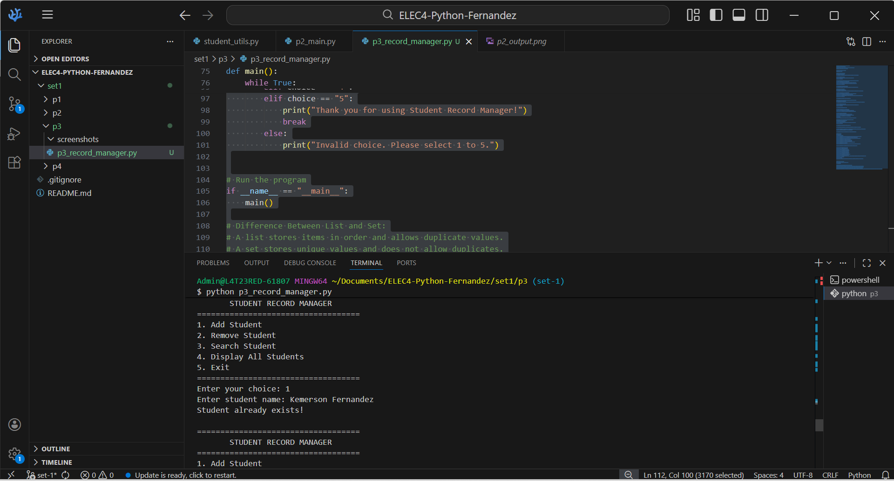

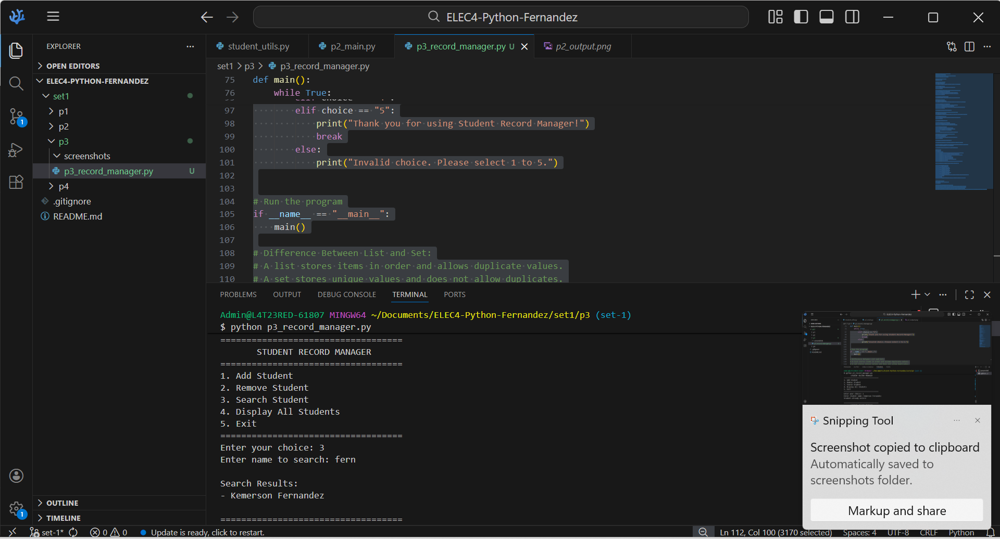

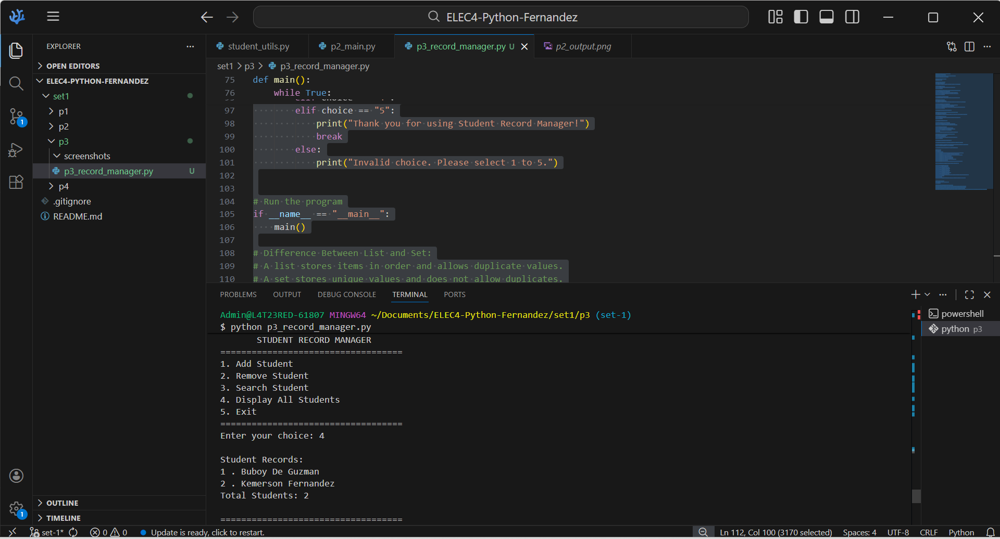

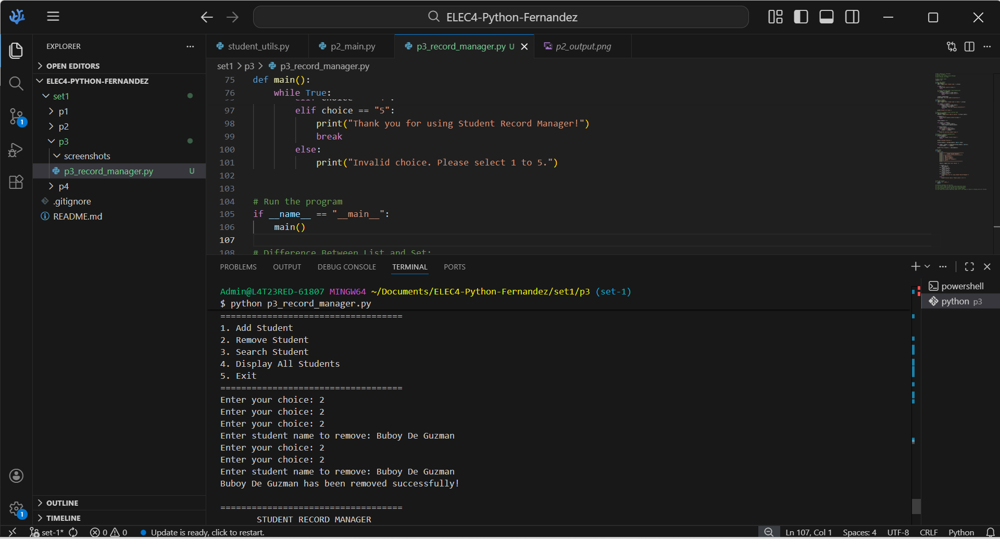

## P4 – Safe Menu Program

This activity demonstrates Python exception handling using try, except, else, and finally. It handles invalid numeric input, division by zero, missing files, and invalid menu selections.

**Test Screenshots:**

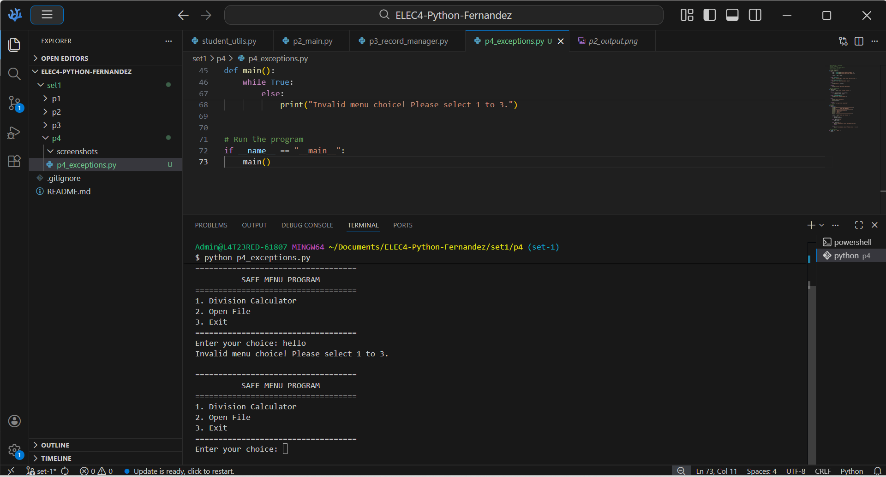

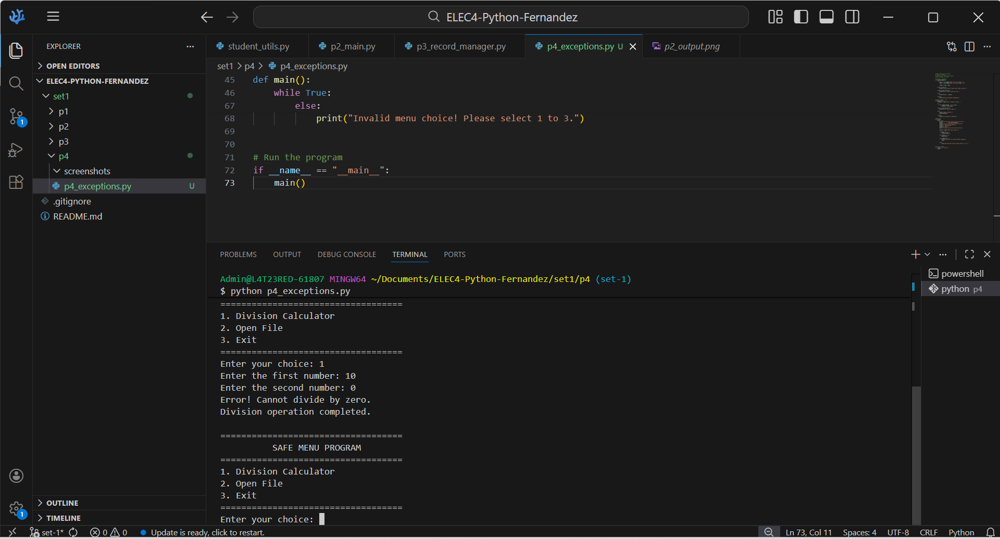

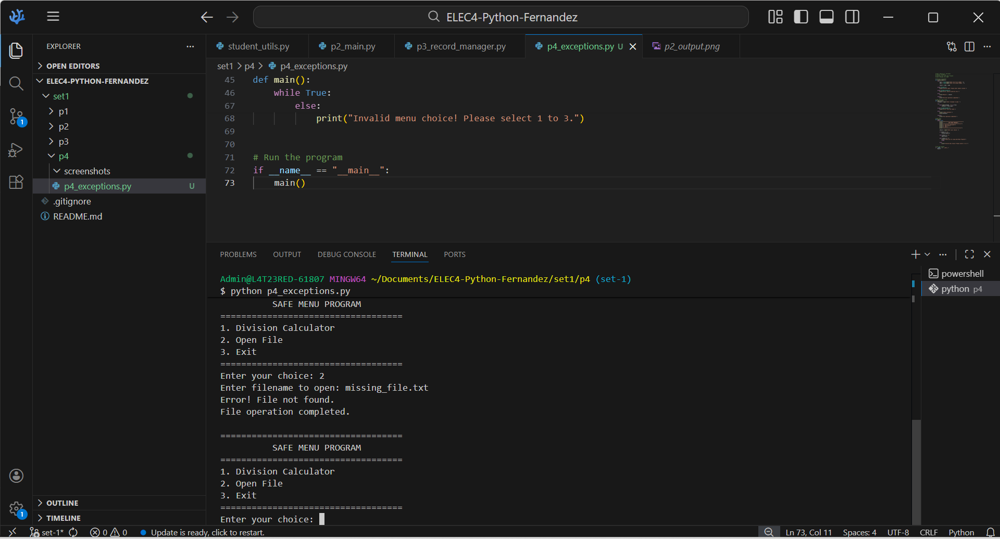

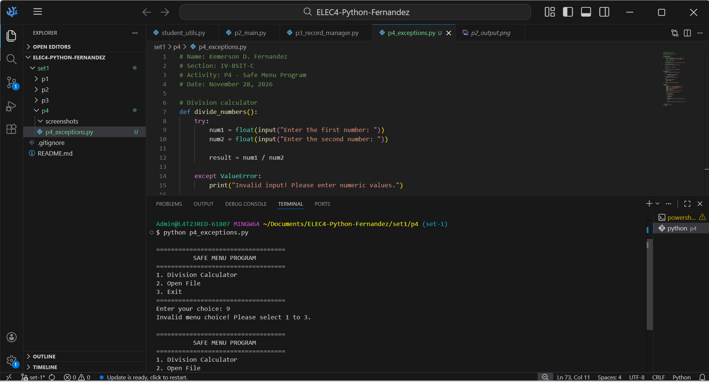

